# 자막 디자인 시스템 th01

DaVinci Resolve 용 Fusion 타이틀 템플릿 12종과 인트로 프리셋 하나. 학교 방송부 영상 세 편(여름방학 인터뷰, 남성역 플리마켓 스케치, 신청곡 홍보)에서 쓴 자막을 하나로 합쳤다. 같은 요소가 여러 번 나온 것은 가장 나은 한 벌만 남겼다. 템플릿은 프로젝트 색 설정에 맞춰 두 벌(기준, 색 관리 없음)로 만든다.

모든 값은 Fusion 값이다. 위치는 `Center` 0~1, 마스크 크기는 픽셀/1920·픽셀/1080, 곡률은 `CornerRadius`, 글자는 Text+ `Size` 다. 색은 원본 컴포지션의 Fusion 색값이거나, 화면색(#hex)으로 정하고 빌드가 BT.709 식으로 Fusion 값을 계산한 것이다. 글자 길이에 따라 바뀌는 알약·상자 폭은 Fusion 이 글자의 `DataWindow` 를 재서 표현식으로 정한다. 폰트 파일로 폭을 추정하거나 렌더에서 색을 되읽은 값은 없다. 픽셀을 글자 크기로 환산한 값은 폼 데모의 폼 글자 크기(`form.size`) 하나뿐이다. 신청곡 홍보 영상 폼 장면의 Text+ Size 를 그대로 옮긴 것인데, 그 영상에서 폼 페이지 글자 px 를 1280 으로 나눠 정한 값이다.

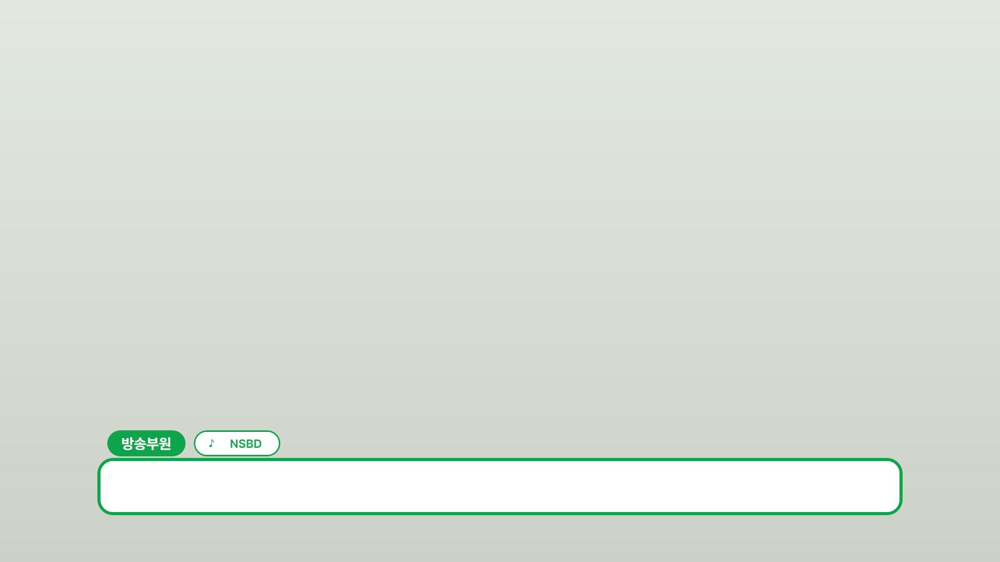

## 요소

| 템플릿 | 미리보기 | 인스펙터에서 고치는 것 | 권장 길이 |
|---|---|---|---|
| th01 자막바 |  | 이름, 아이콘, 소속, 색 | 150 |
| th01 자막 | 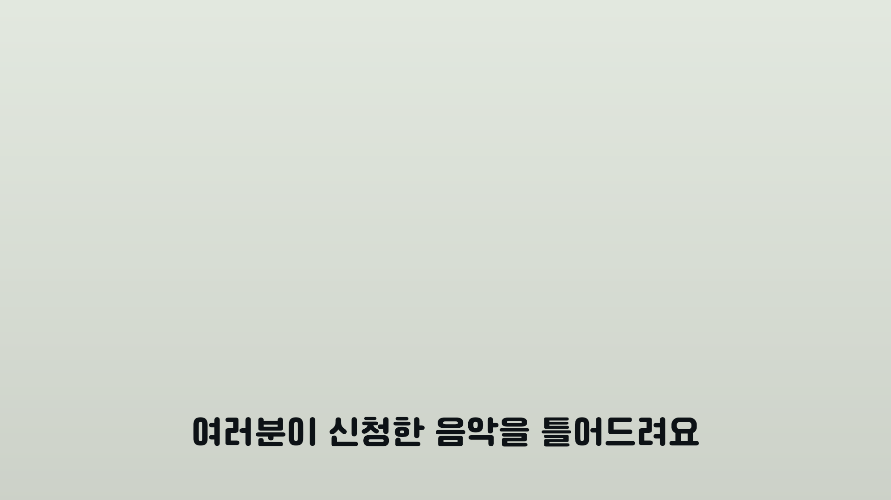 | 자막, 글자색 | 90 |
| th01 질문 | 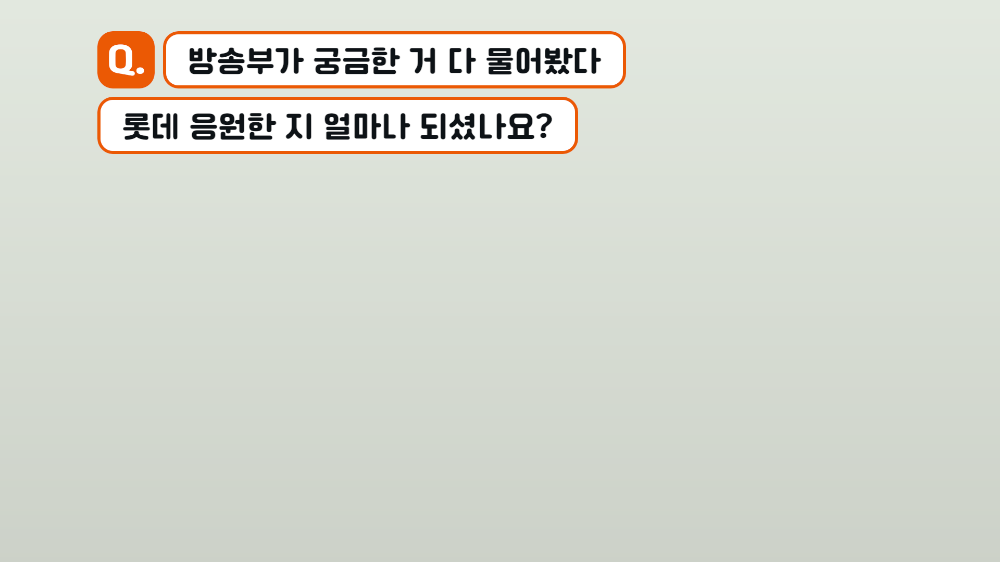 | 파트, 질문, 질문 줄(끄기), 색 | 150 |
| th01 이지선다 | 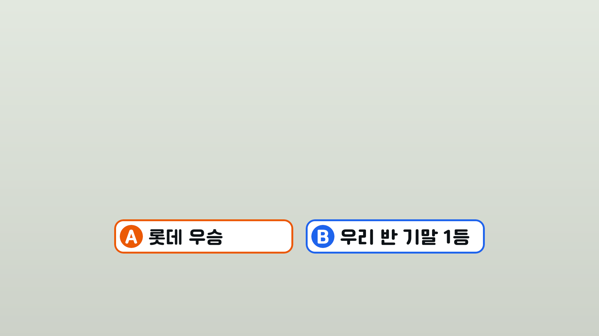 | A, B, A·B 선명도, A·B 색 | 150 |
| th01 안내 카드 | 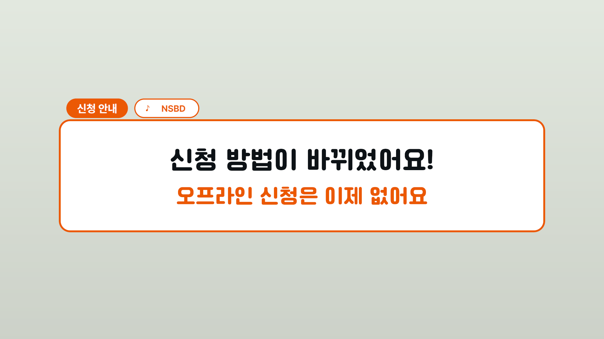 | 큰 줄, 작은 줄, 알약(이름·아이콘·소속), 색, 벽, 내용 페이드 | 120 |
| th01 링크 | 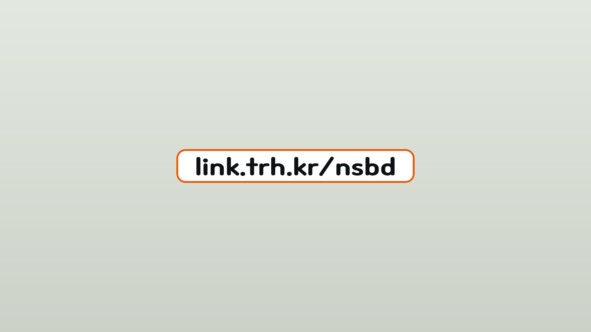 | 링크, 색 | 120 |
| th01 QR 카드 | 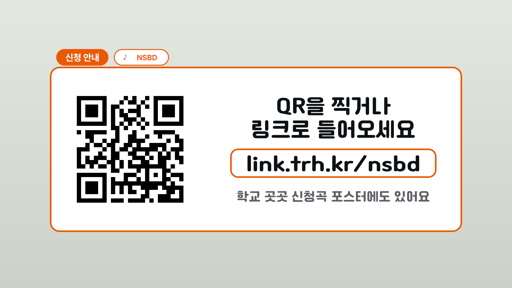 | QR 이미지, 큰 줄 1·2, 링크, 보조 줄, 알약, 색, 벽, 내용 페이드 | 226 |
| th01 폼 데모 | 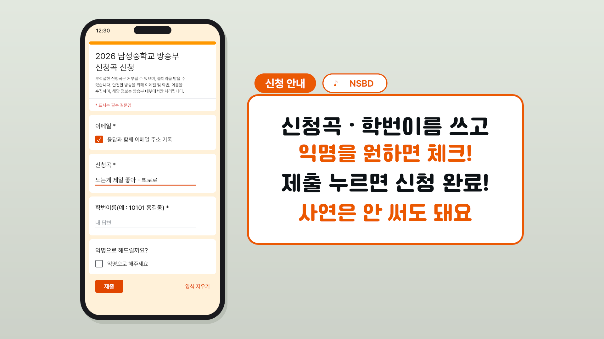 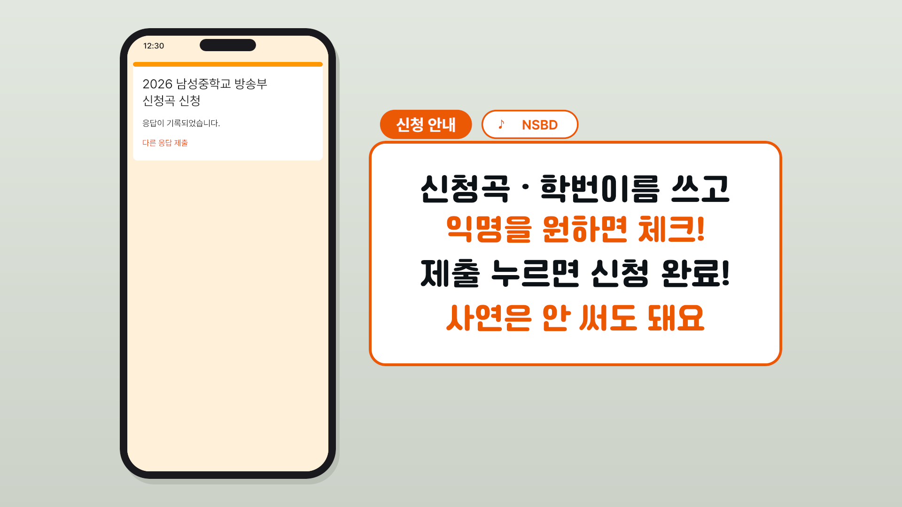 | 폼 글자(아래 목록), 안내 1–4, 알약, 색, 벽, 내용 페이드 | 227 |
| th01 오프닝 타이틀 | 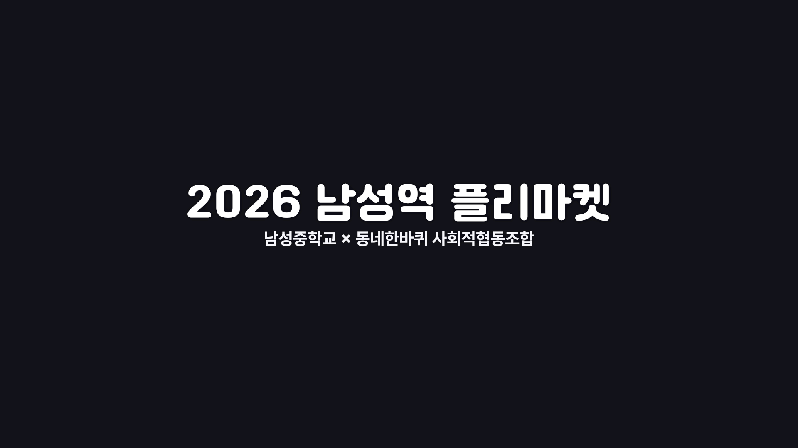 | 제목, 부제 | 151 |
| th01 섹션 타이틀 | 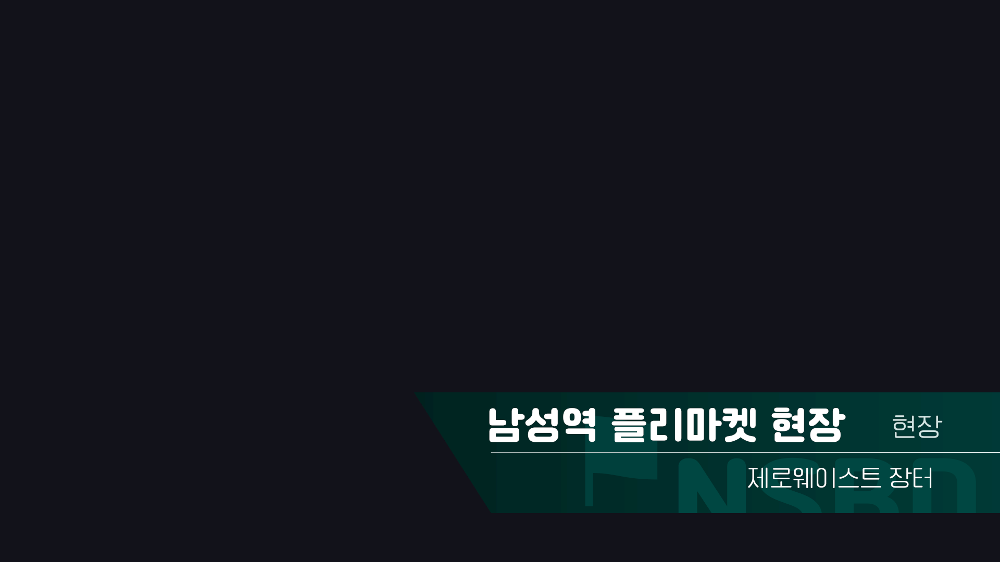 | 제목, 아이콘, 라벨, 부제, 배경 글자 | 184 |
| th01 크레딧 | 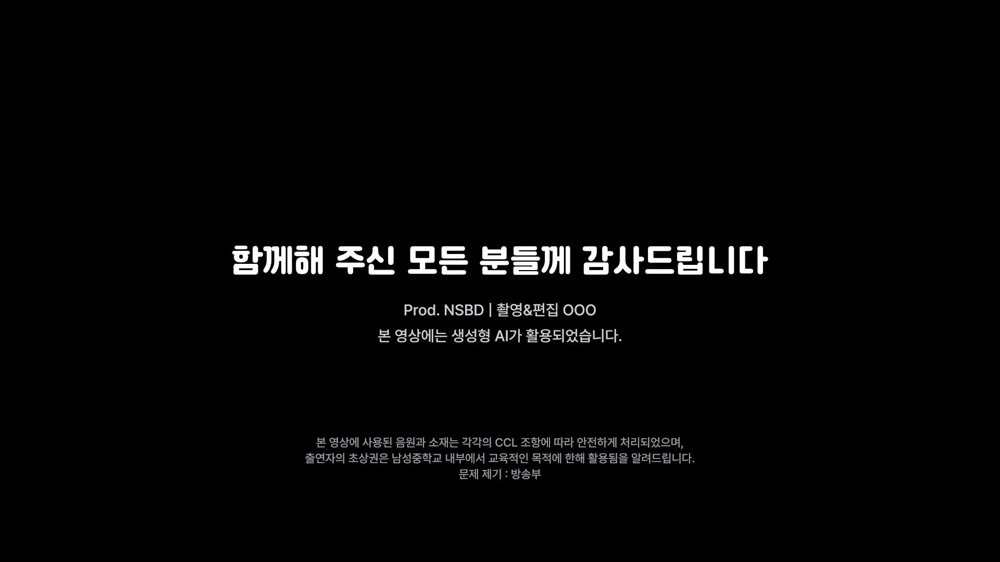 | 큰 줄, 역할, 고지 | 114 |
| th01 워터마크 | 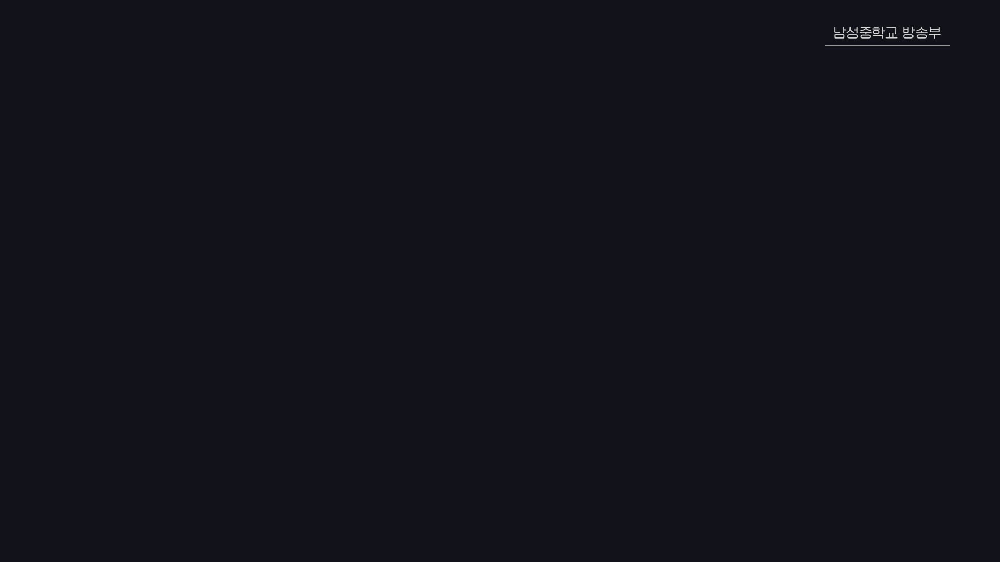 | 글자 | 150 |
| 인트로(프리셋) | [docs/intro.md](docs/intro.md) | 리졸브 기본 'Draw On Corners 1 Line' 에 값만 넣는다 | 73 |

템플릿마다 `th01 … (색 관리 없음)` 이 한 벌 더 있다. 어느 쪽을 쓰는지는 [프로젝트 색 설정](#프로젝트-색-설정)에 있다.

모든 템플릿에 `위치`·`크기` 가 있다. 맨 끝에 붙은 Transform(`th_xf`)의 입력이다. 원본을 감싼 네 개(오프닝·섹션·크레딧·워터마크)는 원본 출력 뒤에 이 Transform 을 붙였고, 원본 노드의 값은 그대로다.

카드 템플릿(안내 카드·QR 카드·폼 데모)은 뒤 벽 그라데이션을 스스로 갖고 있고 기본으로 켜져 있다(인스펙터 `벽` = 1). 영상 위에 카드만 얹으려면 `벽` 을 0 으로 둔다. 크레딧은 원본 컴포지션의 불투명 검은 판이 있어 영상을 가린다.

미리보기는 `scripts/render_previews.py` 가 기준 설정의 프로젝트에서 기준 벌로 뽑은 프레임이다. 카드 템플릿과 크레딧은 템플릿 그대로 뽑고, 나머지에만 미리보기 때 뒤 배경을 깐다. 자막바·자막·질문·이지선다·링크는 벽 그라데이션, 오프닝·섹션·워터마크는 먹색(ink)이다.

### 폼 데모

휴대폰 속 신청 폼이 채워지는 장면과 오른쪽 안내 카드. 애니메이션 프레임은 `form.frames` 에 있다. 이메일 기록 체크 16, 신청곡 입력 34~76, 학번이름 입력 86~116, 익명 체크 130, 제출 150, 완료 화면 162.

인스펙터에서 고치는 폼 글자는 제목 1·2, 설명 1–3, 필수 안내, 문항 1–4, 체크 1·4(체크 상자 옆 글자), 답 2·3(입력되는 답), 버튼, 지우기, 완료 문구, 완료 링크, 시계, 빈칸 1·2(답 자리의 '내 답변')다. 오른쪽 카드는 안내 1–4 와 카드 공통 입력(이름 알약, 아이콘, 소속 알약, 색, 벽, 내용 페이드)이다. 체크 표시(✓)는 입력으로 열지 않는다.

완료 화면은 폼 화면의 제목 Text+ 두 개를 다시 얹어 쓴다. `제목 1`·`제목 2` 를 고치면 두 화면이 같이 바뀐다.

## 설치

```bash
python scripts/install.py
```

`templates/*.setting`(두 벌 24개)을 리졸브 사용자 타이틀 폴더의 `th01` 아래로 복사한다. 리졸브를 다시 켤 필요는 없다. 에디트 페이지 이펙트 → 타이틀 → Fusion 타이틀에 `th01 …` 으로 나온다.

| OS | 폴더 |
|---|---|
| Windows | `%APPDATA%\Blackmagic Design\DaVinci Resolve\Support\Fusion\Templates\Edit\Titles\th01` |
| macOS | `~/Library/Application Support/Blackmagic Design/DaVinci Resolve/Fusion/Templates/Edit/Titles/th01` |
| Linux | `~/.local/share/DaVinciResolve/Fusion/Templates/Edit/Titles/th01` |

## 폰트

폰트 파일은 싣지 않는다. 설치한 뒤 리졸브에서 쓴다.

| 쓰임 | 폰트 | 받는 곳 |
|---|---|---|
| 자막·카드·질문·이지선다·링크, 오프닝 제목, 섹션 제목·배경 글자, 크레딧 큰 줄 | Cafe24 Ssurround Bold | [카페24 무료 폰트](https://fonts.cafe24.com/) |
| 워터마크·섹션 라벨과 부제 | Cafe24 Ssurround air Light | [카페24 무료 폰트](https://fonts.cafe24.com/) |
| 알약(이름·소속)·폼·오프닝 부제·크레딧 역할과 고지 | Pretendard Bold / Regular / Medium / SemiBold | [Pretendard](https://github.com/orioncactus/pretendard) |
| 알약 아이콘·폼 체크 표시·섹션 타이틀 아이콘 | Segoe UI Symbol | Windows 기본 |
| 인트로 | Open Sans Bold | [Google Fonts](https://fonts.google.com/specimen/Open+Sans) |

Segoe UI Symbol 은 Windows 에 들어 있다. macOS·Linux 에서는 아이콘 입력(자막바·카드의 `아이콘`, 섹션 타이틀의 `아이콘`)을 다른 글자로 바꾸거나 이 글리프(♪ ✓ ⚑)가 있는 폰트를 설치한다. 폼 데모의 체크 표시는 입력으로 열려 있지 않아 폰트 쪽에서 해결해야 한다.

## 값

값은 [tokens.json](tokens.json) 에 있고, 빌드가 이 파일에서 읽어 템플릿을 만든다. 예외는 둘이다. 원본을 감싼 네 개는 원본 컴포지션(`source/comps`)의 값을 그대로 쓴다. 폼 데모 휴대폰 화면 안의 세부 배치(폼 카드 높이, 줄 간격, 체크 상자·입력 줄·버튼 자리, 탭 표시의 크기·색 `#1A1A1A`·불투명도, 전환 앞뒤 몇 프레임)는 `build/form.py` 에 있다. 맨 위 상수(`TOP_PAD` 등)와 `form_demo` 안의 수다.

### 색

색은 두 가지로 적는다.

- 목록 `[R, G, B]`: 원본 플리마켓 컴포지션의 Fusion 값(speaker-1~4, ink, paper). 기준 설정에서 원본과 같은 모습이다.
- `{"display": "#hex"}`: 화면색으로 정한 색(wall-top, wall-bottom, muted). 폼 데모의 폼 색(`form.colors`)은 `"#hex"` 문자열로 적고 같게 다룬다. 빌드가 BT.709 OETF 역함수(`elements.inv_oetf`)로 기준 벌의 Fusion 값을 계산하고, (색 관리 없음) 벌에는 hex/255 를 그대로 쓴다. 측정값이 아니라 정해진 식이다.

| 이름 | tokens.json 값 | 쓰임 |
|---|---|---|
| speaker-1 | 0.011289247014021, 0.418478260869565, 0.102974828375286 | 첫 화자 |
| speaker-2 | 0.0292307948434309, 0.168115942028985, 0.855072463768116 | 둘째 화자, 이지선다 B |
| speaker-3 | 0.847826086956522, 0.136231884057971, 0.00372334389287526 | 셋째 화자, 안내·링크·질문·이지선다 A·폼 데모 오른쪽 카드 |
| speaker-4 | 0.247491638795987, 0.0706521739130435, 0.869565217391304 | 넷째 화자 |
| ink | 0.0153261367602296, 0.0175521639615446, 0.0224107262224479 | 자막·카드 큰 줄 |
| paper | 1, 1, 1 | 바·카드·알약 안쪽 |
| wall-top / wall-bottom | 화면색 #E2E8DF / #CCD1C8 | 카드 뒤 벽 |
| muted | 화면색 #5F6368 | 카드 보조 줄 |

폼 데모 폼 색(신청 폼 페이지의 화면색): bg #FFF0D9, accent #E04500, topbar #FF9800, text #1F1F1F, gray #5F6368, light #9AA0A6, red #D93025, line #DADCE0, phone #1B1B1D, shadow #B9BFB5.

### 프로젝트 색 설정

템플릿은 두 벌이다(`pipeline.variants`). 두 벌은 화면에서 같은 모습이 되도록 만든다.

| 벌 | 템플릿 이름 | 쓰는 프로젝트 |
|---|---|---|
| 기준 | `th01 …` | Color science DaVinci YRGB Color Managed v2, Timeline / Output color space Rec.709 (Scene), Working luminance SDR 100. 원본 남성역 플리마켓 프로젝트와 같다 |
| 색 관리 없음 | `th01 … (색 관리 없음)` | DaVinci YRGB(색 관리 없음) |

(색 관리 없음) 벌은 기준 벌의 모든 색 값에 BT.709 OETF 를 적용한 값이다. 원본을 감싼 네 개의 색 입력도 같다(`build/flea.py` 의 `COLOR_INPUT`). 식은 V = 4.5·L (L < 0.018), V = 1.099·L^0.45 − 0.099 (그 밖)이고, 상수는 `pipeline.oetf` 에 있다. 검정 가까이는 두 벌이 조금 다르다. 색 관리 프로젝트의 출력에는 리졸브 DRT 가 더해지기 때문이다.

벌을 잘못 고르면 색이 달라진다. 기준 벌을 색 관리 없는 프로젝트에 넣으면 값×255 가 그대로 화면색이라 더 짙다(speaker-3 이 #EB5904 대신 #D82301).

아래 표는 각 벌을 맞는 프로젝트에서 렌더해 잰 화면색이다. 참고용 측정값이고 템플릿 값으로 쓰지 않는다. 두 벌의 차이는 0~2 단계이고, 검정 가까이(ink)는 DRT 때문에 몇 단계 난다.

| 이름 | 기준 벌 · 기준 설정 프로젝트 | (색 관리 없음) 벌 · 색 관리 없는 프로젝트 |
|---|---|---|
| speaker-1 | #0DA44B | #0DA44C |
| speaker-2 | #1E64EC | #2064EC |
| speaker-3 | #EB5904 | #EB5904 |
| speaker-4 | #7C3CEE | #7C3CEE |
| ink | #0D1216 | #111419 |
| muted | #5E6267 | #5F6368 |
| wall-top / wall-bottom | #E2E8DF / #CCD1C8 | #E2E8DF / #CCD1C8 |

### 자막바

바깥 마스크 Center (0.5, 0.134259259259259), Width 0.805208333333333, Height 0.101851851851852, CornerRadius 0.545454545454545. 안쪽 흰 마스크는 6px 안(Width 0.798958333333333, Height 0.0907407407407407, CornerRadius 0.489795918367347).

이름 알약과 소속 알약은 글자 폭(`DataWindow`)을 재서 폭을 정한다.

- 이름 알약: 왼끝 206px, 폭 = 이름 글자 폭 + 55.2px, 높이 50px, Center.y 0.211111111111111
- 소속 알약: 이름 알약 오른끝 + 16px 에서 시작. 아이콘은 왼끝 + 34px, 글자는 왼끝 + 69px 에서 시작, 오른쪽 여백 35px. 테두리 3px(안쪽 높이 44px)

### 상자·카드

- 링크·질문·이지선다 상자: 자막바와 같은 높이 110px, 같은 곡률. 링크 폭 = 글자 폭 + 좌우 64px씩, 질문 폭 = 글자 폭 + 좌우 48px씩
- 이지선다: A·B 상자 폭은 둘 중 긴 글자 폭 + 158px(왼쪽 원 자리 110 + 오른쪽 48)로 같다. 가운데 간격 40px. 기본 글자는 A '롯데 우승', B '우리 반 기말 1등'
- 안내 카드: 자막바와 같은 폭·왼끝, 높이 360px, 곡률 36px, 테두리 6px, 알약 1.25배. QR 카드는 높이 620px, 폼 데모 오른쪽 카드는 880×480px
- 글자 폭: `DataWindow` 는 타임라인 해상도의 픽셀이라 `×1920/Output.Width` 로 1920 폭 단위로 맞춘다(`elements.dw`). UHD·720p 타임라인에서도 알약·상자 비율이 같다
- 긴 글자: 글자가 자리를 넘으면 Text+ 바로 뒤의 Transform 이 글자만 줄인다(`fit_text`, `place_text`). 배율 = min(1, 자리 ÷ 글자 폭). 상자는 높이 110px·곡률을 그대로 두고 폭만 줄어든 글자에 맞춘다. 이지선다는 A·B 가 한 배율(긴 쪽이 정한다)을 같이 써서 두 상자와 글자가 같은 크기로 남는다. 자리는 자막·카드 글 1418px(바 폭 1546 − 좌우 64), 링크 1418px, 질문 파트 1324px·질문 1450px, 이지선다 한 칸의 글자 595px, QR 카드 오른쪽 칸 870px(링크 글자 742px), 폼 데모 오른쪽 카드 784px. 자리를 안 넘으면 배율 1이라 기본 모양은 그대로다
- QR 이미지: Merge 의 Size 로 긴 변을 528px(1920 기준)에 맞춘다. PNG 크기와 타임라인 해상도(UHD 등)에 상관없다(1056px QR 로 확인). 이미지를 넣지 않으면 배율 1이라 깨지지 않는다
- 카드 내용 페이드: 기본 6프레임(`fade.card_content_frames`). 인스펙터의 `내용 페이드 인/아웃(프레임)` 에서 바꾸고, 0 이면 끈다. 벽은 페이드하지 않는다. 카드 클립 사이 넘김은 편집 페이지 클립 페이드 8프레임(`fade.scene_clip_frames`)을 쓰고, 이 값은 템플릿에 들어가지 않는다

### 배치

픽셀은 1920×1080 기준이고 y 는 위에서부터 잰다. 생성기가 `/1920`·`/1080` 으로 나눠 Fusion 값으로 넣는다.

| 요소 | 값 | tokens.json |
|---|---|---|
| 카드 알약 | 카드 왼끝 + 19px×1.25, 가운데가 카드 윗선 위 28px×1.25 | `layout.card_pill` |
| 질문 | 왼끝 187px, 윗선 60px, 줄 높이 110px, 줄 간격 16px, 글자 여백 48px, Q 글자 3px 위로 | `layout.question` |
| 이지선다 | 세로 760px, 원 74px(상자 왼끝 + 18px), 글자 시작 110px, 오른쪽 여백 48px, 간격 40px | `layout.choice` |
| 링크 | 세로 540px(화면 가운데), 가로 가운데 | `layout.link` |
| QR 카드 | QR 가운데 (488, 560), 528px. 오른쪽 칸 가운데 x 1250, 폭 870px. 큰 줄 y 395·482, 링크 612, 보조 줄 735 | `layout.qr` |
| 폼 데모 휴대폰 | 가운데 (485, 540), 460×960px, 곡률 64px, 화면 16px 안(곡률 48px), 그림자 오른쪽 8px·아래 12px(곡률 66px) | `form.phone` |
| 폼 데모 오른쪽 카드 | 왼끝 785px, 윗선 300px, 880×480px, 글자 여백 48px, 안내 줄 y 400·486·580·675 | `form.card` |

### 글자 크기 (Text+ Size)

| 이름 | Size |
|---|---|
| caption | 0.055648996702227 |
| card-line-1 / card-line-2 | 0.062 / 0.05 |
| link | 0.06 |
| card-note | 0.036 |
| question / choice | 0.045 |
| pill-name / pill-affil / pill-icon | 0.0214715989792402 / 0.0178929991493668 / 0.0187850122438026 |
| 폼 데모 오른쪽 카드 안내 1·3 / 2·4 | 0.052 / 0.05 |

폼 데모의 폼 글자 크기(`form.size`)는 신청곡 홍보 영상 폼 장면의 Text+ Size 그대로다. 위에 적은 대로 그 영상에서 폼 페이지 글자 px ÷ 1280 으로 정한 값이라, 이 시스템에서 픽셀→Size 환산이 남아 있는 유일한 곳이다.

| 이름 | Size |
|---|---|
| title | 0.02109375 |
| desc / req | 0.010546875 / 0.0109375 |
| label / answer | 0.015234375 |
| body | 0.0140625 |
| button | 0.014453125 |
| clear / clock | 0.01328125 |
| tick | 0.01640625 |

## 세 편에서 고른 것

| 요소 | 남긴 것 | 버린 것 |
|---|---|---|
| 자막바 | 플리마켓 자막바(이름·소속 알약) | 여름방학 이름판 — 자막바의 이름 알약으로 합쳤다 |
| 자막 | 플리마켓 자막 | 신청곡 1차의 반투명 상자 자막바 |
| 질문·이지선다 | 여름방학의 구성(Q 배지 + 파트 + 질문, A/B 두 줄) | 여름방학의 모양 — 자막바와 같은 상자·곡률로 다시 만들었다 |
| 안내 카드·링크·QR·폼 데모 | 신청곡 홍보 | 링크만 곡률이 다르던 것(자막바 곡률로 맞췄다) |
| 오프닝·섹션·크레딧·워터마크 | 플리마켓 원본 컴포지션 | — |
| 파트 타이틀 | — | 여름방학 파트 타이틀 — 안내 카드와 섹션 타이틀로 합쳤다 |
| 인트로 | 여름방학 Prod. 인트로 | 템플릿 자체는 블랙매직 것이라 값만 프리셋으로 남겼다 |

플리마켓 원본 네 개(`source/comps`)는 리졸브가 내보낸 컴포지션을 매크로로 감쌌다. 원본 노드의 값은 바꾸지 않는다. 빌드가 하는 일은 MediaOut 제거, 원본 클립 길이에 묶인 GlobalIn/GlobalOut 제거, 고칠 글자 입력 열기, 출력 뒤 위치·크기 Transform 추가이고, (색 관리 없음) 벌에서는 색 입력 값에 BT.709 OETF 를 적용한다. 크레딧의 기본 글자에 있던 실명은 `source/comps` 파일에서 `OOO` 로 바꿔 실었다.

## 다시 만들기

```bash
python build/build.py            # tokens.json → templates/*.setting (두 벌)
python build/build.py --install  # 만들고 바로 리졸브 폴더에 복사
python build/check_cycles.py     # templates/ 만 따로 검사
```

`build/build.py` 는 두 벌을 다 만든 뒤 문법 검사(괄호 짝, 빠진 쉼표)와 순환 검사(`build/check_cycles.py`)를 한다. 리졸브는 문법이 틀린 `.setting` 을 말없이 빈 컴포지션으로 넣고, 순환이 있으면 Fusion 이 프레임을 끝내지 못해 리졸브가 멈춘다. 하나라도 걸리면 빌드는 설치하지 않고 멈춘다.

`build/fu.py` 는 Fusion `.setting` 을 쓰는 도구(Lua 표 직렬화, 노드, 매크로), `build/elements.py`·`form.py` 는 요소 여덟 개, `build/flea.py` 는 원본 컴포지션 네 개를 감싼다.

## 스크립트

`scripts/render_previews.py` 와 `scripts/intro_preset.py` 는 리졸브 스크립팅으로 돈다. 준비는 이렇다.

- 리졸브를 켜 둔다.
- 환경설정 → System → General → External scripting using 을 Local 로 둔다.
- 스크립팅 모듈은 `scripts/resolve_env.py` 가 블랙매직 기본 설치 경로에서 찾는다. 다른 곳에 있으면 `RESOLVE_SCRIPT_API`(Developer/Scripting 폴더)와 `RESOLVE_SCRIPT_LIB`(fusionscript 라이브러리) 환경 변수로 알려 준다.

```bash
python scripts/install.py
python scripts/render_previews.py [출력 폴더] [--variant cm|yrgb] [--only 이름,이름] [--size 3840x2160]
python scripts/intro_preset.py [글자]
```

`render_previews.py` 는 설치된 템플릿을 지금 열린 프로젝트의 임시 타임라인 `_th01_preview` 에 하나씩 깔고, 컬러 페이지에서 정해 둔 프레임을 PNG 로 뽑은 뒤 타임라인을 지운다. 출력 폴더 기본값은 `docs/img` 다. `--variant cm`(기본)은 기준 설정의 프로젝트에서, `--variant yrgb` 는 색 관리 없는 프로젝트에서 돌린다. `--only` 는 파일 이름(`subtitle-bar`, `caption`, `question`, `two-choice`, `info-card`, `link`, `qr-card`, `form-demo`, `opening`, `section`, `credits`, `watermark`)으로 고르고, `--size` 는 임시 타임라인 해상도를 바꾼다.

`intro_preset.py` 는 `tokens.json` 의 `intro` 값을 읽어 재생헤드 위치에 인트로를 넣는다. 29.97·59.94 드롭 프레임 타임코드도 센다. 자세한 것은 [docs/intro.md](docs/intro.md).

## 구조

```
tokens.json          값
templates/           설치할 .setting 24개(12종 × 두 벌)
build/               생성기: build.py · elements.py · form.py · flea.py · fu.py · check_cycles.py(문법·순환 검사)
source/comps/        플리마켓 원본 컴포지션 4개
scripts/             install.py · render_previews.py · intro_preset.py · resolve_env.py(리졸브 연결·타임코드)
docs/                intro.md · img/ · qr-sample.png
_board/              작업 기록: TODO · DONE · DECISIONS · NEEDS-USER
```

## 라이선스

[MIT](LICENSE). 폰트와 리졸브 기본 템플릿은 각자의 라이선스를 따른다.
